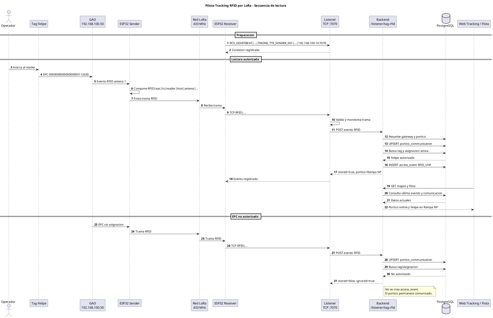
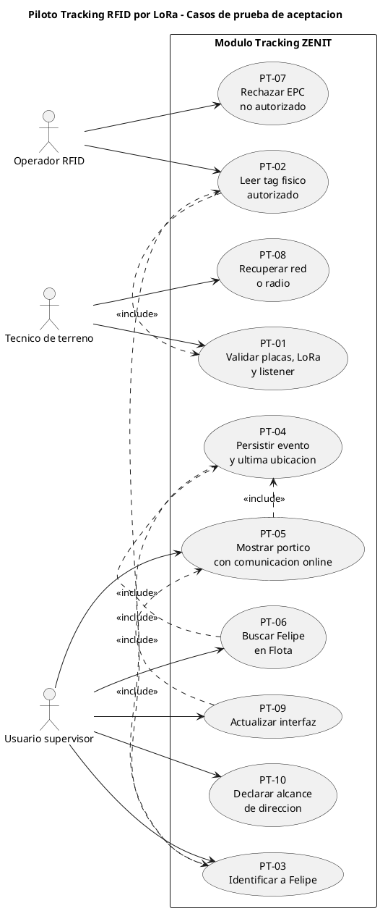

# Plan de Pruebas y Demostracion - Piloto Tracking RFID por LoRa

**Documento:** Plan de pruebas de aceptacion de usuario y demostracion operativa  
**Modulo:** Tracking de personas por RFID UHF, LoRa y aplicacion ZENIT/TMOne  
**Fecha:** 2026-09-02  
**Version:** 1.0  
**Estado:** Preparado para ejecucion en piloto

---

## Prompt para IA: generar documento Word

Copiar el siguiente prompt junto con este archivo Markdown al solicitar la conversion a Word:

```prompt
Actua como especialista en aseguramiento de calidad industrial y documentacion tecnica. Convierte el contenido de este Markdown en un documento Word profesional, en espanol, titulado "Plan de Pruebas y Demostracion - Piloto Tracking RFID por LoRa".

Conserva toda la informacion tecnica, tablas, consultas SQL, criterios de aprobacion y riesgos. No inventes direcciones IP, resultados de prueba, configuraciones, capturas ni conclusiones que no esten en el documento.

Usa una portada con titulo, modulo, version, fecha, estado y espacios para Responsable de Prueba, Tecnico de Terreno y Usuario Validador. Genera tabla de contenido automatica, numeracion de paginas, encabezado con el titulo abreviado y pie de pagina con version y fecha.

Mantiene las tablas como tablas editables de Word. Formatea las consultas SQL y bloques tecnicos en fuente monoespaciada. Destaca las pruebas criticas, los criterios de aprobacion y la limitacion de alcance sobre direccion de transito.

Renderiza los tres bloques PlantUML incluidos en el anexo como diagramas PNG o SVG e insertalos en Word con estos titulos: "Figura 1. Arquitectura de componentes", "Figura 2. Secuencia de lectura RFID" y "Figura 3. Casos de prueba de aceptacion". Si no puedes renderizarlos, conserva el codigo PlantUML en un anexo tecnico y deja un marcador claramente identificado para insertar cada figura.

Incluye al final una pagina de aprobacion con nombre, cargo, firma y fecha para Responsable de Prueba y Usuario Validador. El resultado debe ser apto para entregar como protocolo de piloto y registrar evidencia en terreno.
```

## 1. Objetivo

Demostrar, frente a usuarios operacionales y tecnicos, que una lectura RFID fisica puede recorrer de forma automatica todo el flujo de Tracking: lector GAO, placa sender, radio LoRa, placa receiver, listener, backend, base de datos y aplicacion web.

La demostracion debe comprobar dos resultados de negocio:

1. El sistema identifica a la persona portadora de un tag RFID autorizado.
2. La aplicacion actualiza su ultima ubicacion en el portico configurado y expone la salud de comunicacion del portico.

## 2. Alcance

### Incluido

- Lectura RFID UHF del tag fisico asignado a Felipe Alfonso Cabezas Cisterna.
- Transporte de lectura mediante la pareja de placas ESP32 sender/receiver y LoRa a 433 MHz.
- Recepcion TCP en el listener y reenvio al endpoint del backend.
- Persistencia de eventos de acceso y de comunicacion tecnica del portico.
- Visualizacion del portico y de la persona en Tracking y Flota.
- Manejo de EPC no registrado o no asignado.
- Recuperacion operacional tras interrupciones controladas de red o radio.

### No incluido en esta etapa

- Medicion de cobertura, capacidad o disponibilidad durante turnos completos.
- Validacion de multiples porticos o multiples pares LoRa.
- Prueba de direccion real de transito entrada/salida.
- Alarmas por equipo fuera de portico autorizado, camaras o variables ambientales.

> El portico piloto usa modo `READ`, antena de entrada `1` y no tiene antena de salida. Por lo tanto, el resultado verificable del piloto es **presencia y ultima ubicacion**, no direccion de cruce. La direccion requiere dos antenas configuradas y modo `ACCESS`.

## 3. Caso piloto configurado

| Elemento | Valor de referencia | Uso en la prueba |
|---|---|---|
| Persona | Felipe Alfonso Cabezas Cisterna | Identidad que se debe visualizar en la aplicacion |
| RUT | `16006352-1` | Validacion SQL de identidad |
| EPC RFID | `000000000000000000112630` | Tag fisico autorizado |
| Reader GAO | `192.168.100.50` | Fuente de la lectura RFID |
| Antena RFID | `ANT1` / puerto `1` | Antena asociada al portico |
| Portico | `1.-SOC. ACC RAMPA NP` | Punto de tracking esperado |
| Zona | `Rampa NP` | Zona que debe aparecer en el evento |
| Mapa | `Diamante - NP` (`NP_dia`) | Mapa de visualizacion |
| Sender | `TMONE_TTE_SENDER_001`, IP estatica `192.168.100.51` | Recibe GAO y transmite LoRa |
| Receiver | `TMONE_TTE_RECEIVER_001`, IP estatica `192.168.100.53` | Recibe LoRa y envia TCP |
| Radio | LoRa 433 MHz, `PAIR_ID=0001` | Enlace inalambrico del piloto |
| Listener | `192.168.100.10:7070` | Ingesta TCP de tramas RFID |
| Monitor listener | `http://<IP-listener>:8080` | Evidencia operativa del enlace |
| Aplicacion web | `http://<IP-web>:8081` | Evidencia de negocio para usuario |

La configuracion de identidad y del vinculo reader-portico se encuentra en [db/20260728_enlazar_rfid_felipe_portico_rampa_np.sql](db/20260728_enlazar_rfid_felipe_portico_rampa_np.sql). Para un ambiente aislado, [db/prueba_lora.sql](db/prueba_lora.sql) prepara el piloto completo, pero elimina el historial de `access_event`; no usarlo sobre una base productiva con historial que deba conservarse.

## 4. Arquitectura y trazabilidad

El sistema procesa la lectura en este orden:

1. El tag de Felipe es detectado por el reader GAO en la antena 1.
2. El sender recibe el evento del GAO por stream o webhook HTTP en el puerto `7071` y lo compacta a una trama `RFID|...`.
3. El sender transmite la trama al receiver por LoRa.
4. El receiver abre una conexion TCP al listener en `192.168.100.10:7070` y reenvia la trama.
5. El listener valida el formato, registra el evento de monitoreo y llama a `POST /listener/tag-rfid` en el backend.
6. El backend vincula EPC, reader, antena y portico; persiste un `access_event` para el tag autorizado.
7. El backend actualiza `portico_communication` para señalar que el portico tiene comunicacion reciente, incluso si el EPC no esta autorizado.
8. La aplicacion consulta las API de mapas y flota para representar el portico online y la ultima ubicacion de Felipe.

Los fuentes PlantUML editables estan en:

- [modelos/zenit_piloto_tracking_componentes.puml](modelos/zenit_piloto_tracking_componentes.puml)
- [modelos/zenit_piloto_tracking_secuencia.puml](modelos/zenit_piloto_tracking_secuencia.puml)
- [modelos/zenit_piloto_tracking_casos_prueba.puml](modelos/zenit_piloto_tracking_casos_prueba.puml)

Los mismos codigos se incluyen completos en el **Anexo A**, de modo que este documento se pueda entregar a una IA o herramienta de conversion sin depender de archivos externos. Generar las imagenes PNG o SVG con PlantUML y agregarlas en las secciones de arquitectura, flujo y cobertura de pruebas del documento Word.

## 5. Roles durante la demostracion

| Rol | Responsabilidad |
|---|---|
| Responsable de prueba | Ejecuta el guion, registra resultados y declara aprobacion o rechazo. |
| Operador RFID | Porta y acerca el tag de Felipe al reader en el punto de lectura. |
| Tecnico de terreno | Verifica energizacion, antenas, red Ethernet, logs seriales y enlace LoRa. |
| Operador de plataforma | Mantiene abiertos monitor listener, consultas SQL y aplicacion web. |
| Usuario validador | Observa los resultados desde la aplicacion y acepta los criterios funcionales. |

## 6. Preparacion previa

### 6.1 Ambiente y servicios

1. Confirmar que la red permite comunicacion entre `192.168.100.50`, sender, receiver y `192.168.100.10`.
2. Encender el reader GAO, sender, receiver y el servidor antes de iniciar la demostracion.
3. Iniciar los servicios del ambiente con `docker compose up --build` o mediante el procedimiento operativo definido para el servidor.
4. Confirmar disponibilidad de los servicios:

```text
Aplicacion web:  http://<IP-web>:8081
Backend health:  http://<IP-backend>:8000/api/health
Listener health: http://<IP-listener>:8080/health
Listener TCP:    <IP-listener>:7070
```

5. Abrir el monitor del listener e iniciar sesion con las credenciales administrativas definidas para el ambiente.
6. Abrir la aplicacion en Tracking, seleccionar `Diamante - NP` y dejar disponible la vista Flota.
7. Abrir una consola serial por placa, si se requiere evidencia tecnica adicional. El firmware tiene diagnosticos seriales habilitados.

### 6.2 Integridad de configuracion

Ejecutar la siguiente consulta antes de iniciar. Debe devolver una fila para Felipe, el EPC y el portico Rampa NP:

```sql
SELECT
  p.full_name,
  p.rut,
  t.code AS epc,
  ap.name AS portico,
  ap.zone,
  ap.operating_mode,
  ap.antenna_in_port,
  ap.antenna_out_port,
  g.name AS gateway_reader
FROM person p
JOIN tag_assignment ta ON ta.entity_type = 'person'
  AND ta.entity_id = p.id
  AND ta.active = TRUE
JOIN tag t ON t.id = ta.tag_id
LEFT JOIN access_portico ap ON ap.name = '1.-SOC. ACC RAMPA NP'
LEFT JOIN gateway g ON g.id = ap.gateway_id
WHERE p.rut = '16006352-1';
```

Comprobar que el receiver mantiene el destino configurado `192.168.100.10:7070` y que sender/receiver comparten `PAIR_ID=0001`, frecuencia `433000000 Hz` y parametros de radio. Si se debe recompilar o cargar firmware, usar las tareas `Arduino: Build Sender`, `Arduino: Build Receiver`, `Arduino: Upload Sender` y `Arduino: Upload Receiver` del espacio de trabajo.

### 6.3 Evidencias a capturar

Crear una carpeta de evidencia con fecha, por ejemplo `artifacts/test-results/piloto_tracking_YYYYMMDD/`, y capturar:

- Foto de las placas, antenas y tag utilizado.
- Captura del monitor listener antes y despues de la lectura.
- Captura de consola sender/receiver, cuando este disponible.
- Captura SQL del ultimo evento y de comunicacion del portico.
- Captura del mapa Tracking y de Flota mostrando Felipe.
- Planilla de ejecucion firmada por responsable de prueba y usuario validador.

## 7. Plan de pruebas de aceptacion

| ID | Escenario de usuario | Procedimiento | Resultado esperado | Evidencia minima | Prioridad |
|---|---|---|---|---|---|
| PT-01 | El operador confirma que las placas y el listener estan operativos. | Encender sender y receiver; esperar heartbeats y enlace LoRa. | Monitor muestra `TMONE_TTE_RECEIVER_001`, sender enlazado, destino `192.168.100.10:7070` y sin fallas TCP. | Captura de monitor receiver. | Critica |
| PT-02 | El sistema recibe una lectura fisica RFID. | Acercar el tag de Felipe al reader GAO en Rampa NP. | El sender registra evento GAO, receiver recibe LoRa y listener registra `RFID por LoRa recibido`. | Monitor listener y/o consolas. | Critica |
| PT-03 | El sistema identifica al portador del tag. | Esperar respuesta del backend tras PT-02. | El listener registra RFID guardado, no ignorado; el EPC corresponde a Felipe. | Monitor y consulta SQL. | Critica |
| PT-04 | El sistema registra la ultima ubicacion. | Consultar `access_event` luego de PT-02. | Existe evento `rfid`/`RFID_UHF`, zona `Rampa NP`, portico Rampa NP, antena 1 y fecha/hora actual. | Resultado SQL. | Critica |
| PT-05 | El pórtico informa salud tecnica. | Actualizar la vista Tracking despues de una lectura. | Marcador del portico aparece online y con ultima comunicacion reciente. | Captura del mapa. | Alta |
| PT-06 | Un usuario encuentra a Felipe en Flota. | Abrir Flota, filtrar Personas y buscar `Felipe`. | Se muestra Felipe en `1.-SOC. ACC RAMPA NP`, zona Rampa NP, con ultima lectura actualizada. | Captura de Flota. | Critica |
| PT-07 | Un EPC no autorizado no genera una presencia falsa. | Presentar un EPC distinto sin registro/asignacion. | El pórtico se mantiene comunicado, pero el backend responde ignorado y no crea `access_event` para identidad inexistente. | Monitor, SQL y mapa. | Alta |
| PT-08 | El sistema se recupera tras cortar radio o red. | Apagar sender o interrumpir Ethernet del receiver; restaurar el componente. | El monitor refleja la perdida; al recuperar, vuelven heartbeats/enlace y PT-02 funciona sin reinicio del servidor. | Capturas antes/despues. | Media |
| PT-09 | La interfaz actualiza el estado operativo. | Mantener Tracking abierto durante PT-02. | El mapa refresca dispositivos cada 30 segundos; si se requiere inmediatez, actualizar manualmente la vista. | Captura con hora posterior. | Media |
| PT-10 | Direccion de transito. | Revisar configuracion del portico. | Se declara fuera de alcance: modo `READ`, una antena. No aprobar como entrada/salida. | Consulta de configuracion. | Informativa |

## 8. Guion de demostracion

Duracion sugerida: 15 a 20 minutos.

| Minuto | Actividad | Mensaje para el usuario | Resultado observable |
|---|---|---|---|
| 0-2 | Presentar objetivo y arquitectura. | “Seguiremos una lectura real desde el tag hasta la aplicacion.” | Diagrama de componentes. |
| 2-4 | Mostrar identificacion configurada. | “Este EPC pertenece a Felipe y se lee en Rampa NP.” | Consulta SQL de configuracion. |
| 4-6 | Mostrar salud del enlace antes de la lectura. | “Las dos placas estan enlazadas y el receiver conoce al listener.” | Monitor listener con heartbeat. |
| 6-8 | Ejecutar lectura fisica. | “Felipe pasa su tag por el reader GAO.” | Log sender, receiver y evento RFID en listener. |
| 8-10 | Confirmar persistencia. | “La lectura no es solo una señal: queda trazada con hora, pórtico y antena.” | Consulta de `access_event`. |
| 10-12 | Mostrar Tracking. | “Rampa NP esta comunicada y refleja la lectura reciente.” | Portico online en mapa. |
| 12-14 | Mostrar Flota. | “Un supervisor puede buscar a Felipe y conocer su ultima ubicacion.” | Resultado de Felipe en Flota. |
| 14-16 | Mostrar control de EPC no autorizado. | “El sistema diferencia salud de hardware de identidad valida.” | Evento ignorado y pórtico online. |
| 16-20 | Cierre y registro de aceptacion. | “Los criterios criticos se aprobaron con evidencia trazable.” | Planilla de resultados. |

## 9. Consultas SQL de verificacion

### 9.1 Ultimos eventos de Felipe

```sql
SELECT
  ae.ts_edge,
  ae.ts_ingested,
  ae.direction,
  ae.kind,
  ae.signal,
  ae.rssi,
  ae.zone,
  ae.extra->>'portico_name' AS portico,
  ae.extra->>'reader_code' AS reader,
  ae.extra->>'antenna_port' AS antena,
  ae.extra->>'direction_logic' AS logica
FROM access_event ae
JOIN tag t ON t.id = ae.tag_id
WHERE t.code = '000000000000000000112630'
ORDER BY COALESCE(ae.ts_edge, ae.ts_ingested) DESC
LIMIT 10;
```

### 9.2 Estado tecnico del portico

```sql
SELECT
  ap.name AS portico,
  ap.zone,
  pc.last_seen_at,
  pc.last_reader_code,
  pc.last_epc,
  CASE
    WHEN pc.last_seen_at >= NOW() - INTERVAL '10 minutes' THEN 'online'
    ELSE 'offline'
  END AS estado_esperado
FROM access_portico ap
LEFT JOIN portico_communication pc ON pc.portico_id = ap.id
WHERE ap.name = '1.-SOC. ACC RAMPA NP';
```

### 9.3 Control de EPC no autorizado

Reemplazar el valor por el EPC de prueba no autorizado. La consulta debe devolver cero eventos vinculados a ese EPC, mientras la consulta 9.2 debe mostrar hora de comunicacion actualizada:

```sql
SELECT ae.*
FROM access_event ae
JOIN tag t ON t.id = ae.tag_id
WHERE t.code = '<EPC_NO_AUTORIZADO>'
ORDER BY ae.ts_ingested DESC;
```

## 10. Criterios de aprobacion

El piloto se considera aprobado cuando se cumplan los siguientes criterios:

- PT-01 a PT-06 obtienen resultado `Aprobado`.
- La lectura fisica de Felipe se visualiza en listener, base de datos y aplicacion sin intervencion manual de datos.
- El evento incluye EPC autorizado, pórtico Rampa NP y una marca temporal coherente con el instante de prueba.
- El portico queda online despues de la lectura.
- Un EPC no autorizado no se convierte en una persona o movimiento valido.
- No existen fallas TCP persistentes en receiver durante la lectura aprobada.

El piloto queda condicionado o rechazado si falla algun escenario critico, si los componentes no pueden vincularse al mismo evento, o si la aplicacion muestra una ubicacion distinta al pórtico configurado.

## 11. Matriz de ejecucion

Completar durante el piloto.

| ID | Fecha/hora | Ejecutor | Resultado (Aprobado/Rechazado/Bloqueado) | ID o archivo de evidencia | Observaciones |
|---|---|---|---|---|---|
| PT-01 |  |  |  |  |  |
| PT-02 |  |  |  |  |  |
| PT-03 |  |  |  |  |  |
| PT-04 |  |  |  |  |  |
| PT-05 |  |  |  |  |  |
| PT-06 |  |  |  |  |  |
| PT-07 |  |  |  |  |  |
| PT-08 |  |  |  |  |  |
| PT-09 |  |  |  |  |  |
| PT-10 |  |  |  |  |  |

## 12. Riesgos y contingencias

| Riesgo | Indicador | Accion inmediata |
|---|---|---|
| Sender y receiver sin enlace | Heartbeat sin sender enlazado o `link_active=false`. | Revisar energizacion, antenas, configuracion comun `PAIR_ID` y radio 433 MHz. |
| Receiver no llega al listener | `tcp_fail_count` aumenta o no hay evento TCP. | Validar cable/red, IP del receiver, puerto `7070` y destino `DEST_HOST`. |
| Listener no guarda el evento | Monitor RFID recibe pero backend responde error. | Revisar `BACKEND_BASE_URL`, salud del backend y logs listener/backend. |
| EPC ignorado inesperadamente | Evento listener con estado `ignored`. | Revisar tag, `tag_assignment.active`, EPC exacto y persona Felipe. |
| Evento sin pórtico | `portico_id` nulo o zona vacia. | Revisar `gateway_id`, `listener_aliases`, reader `192.168.100.50` y antena 1. |
| Pórtico no aparece online en mapa | Ultima comunicacion vacia o antigua. | Revisar `portico_communication`, asociacion de `map_device` al pórtico y refrescar mapa. |
| Flota no muestra el cambio | Evento existe, pero vista conserva estado anterior. | Recargar Flota; la vista de mapa tiene polling de 30 segundos y Flota consulta al cargar/cambiar filtros. |

## 13. Mejoras posteriores al piloto

1. Instalar y configurar segunda antena para habilitar secuencias de entrada/salida en modo `ACCESS`.
2. Agregar actualizacion periodica a la vista Flota para que no dependa de recarga manual.
3. Medir latencia extremo a extremo desde `ts_edge` hasta visualizacion web.
4. Ejecutar pruebas de cobertura LoRa y recuperacion con duraciones representativas de terreno.
5. Incorporar exportacion automatica de evidencias y resultado de prueba desde el monitor.

## 14. Referencias tecnicas

- [backend/app/routers/tag_listener.py](backend/app/routers/tag_listener.py): validacion RFID, asociacion a portico, persistencia y pulso de comunicacion.
- [backend/app/routers/maps.py](backend/app/routers/maps.py): estado online/offline de pórticos y datos de Flota.
- [listener/app/ingest_tcp.py](listener/app/ingest_tcp.py): parseo de trama RFID, heartbeats y reenvio a backend.
- [listener/.env.example](listener/.env.example): puertos y configuracion referencial del listener.
- [firmware_arduino/01.-portico_produccion_new/zenit_lora_radio_config.h](firmware_arduino/01.-portico_produccion_new/zenit_lora_radio_config.h): identidad de pareja y radio LoRa compartida.
- [firmware_arduino/01.-portico_produccion_new/ZENIT_portico_v7_prod_sender/ZENIT_portico_v7_prod_sender.ino](firmware_arduino/01.-portico_produccion_new/ZENIT_portico_v7_prod_sender/ZENIT_portico_v7_prod_sender.ino): ingreso GAO y envio LoRa.
- [firmware_arduino/01.-portico_produccion_new/ZENIT_portico_v7_prod_receiver/ZENIT_portico_v7_prod_receiver.ino](firmware_arduino/01.-portico_produccion_new/ZENIT_portico_v7_prod_receiver/ZENIT_portico_v7_prod_receiver.ino): reenvio TCP al listener.
- [db/20260728_tracking_portico_communication.sql](db/20260728_tracking_portico_communication.sql): tabla de salud de comunicacion por portico.

## Anexo A. Codigo PlantUML para figuras del documento

### A.1 Figura 1. Arquitectura de componentes

```plantuml
@startuml
title Piloto Tracking RFID por LoRa - Arquitectura de componentes
left to right direction
skinparam componentStyle rectangle
skinparam shadowing false

actor "Operador" as operator
component "Tag RFID UHF\nEPC 000000000000000000112630" as tag
component "Reader GAO\n192.168.100.50\nAntena 1" as gao
component "ESP32 Sender\nTMONE_TTE_SENDER_001\n192.168.100.51:7071" as sender
cloud "LoRa 433 MHz\nPAIR_ID=0001" as lora
component "ESP32 Receiver\nTMONE_TTE_RECEIVER_001\n192.168.100.53" as receiver
component "ZENIT Listener\nMonitor HTTP :8080\nIngesta TCP :7070" as listener
component "Backend FastAPI\nPOST /listener/tag-rfid\nGET /control/maps/*" as backend
database "PostgreSQL\naccess_event\nportico_communication\ntag_assignment" as db
component "Aplicacion Web\nTracking y Flota\n:8081" as web

operator --> tag : porta
tag --> gao : lectura RFID
gao --> sender : stream o webhook HTTP
sender --> lora : trama RFID compacta
lora --> receiver : radio
receiver --> listener : TCP RFID|...\n+heartbeat
listener --> backend : HTTP JSON
backend --> db : consulta y persistencia
web --> backend : API de mapas y flota
operator --> web : consulta ubicacion

note bottom of backend
EPC autorizado: crea access_event.
Todo EPC recibido en portico configurado:
actualiza portico_communication.
end note
@enduml
```



### A.2 Figura 2. Secuencia de lectura RFID



### A.3 Figura 3. Casos de prueba de aceptacion


